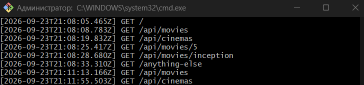
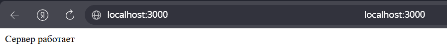
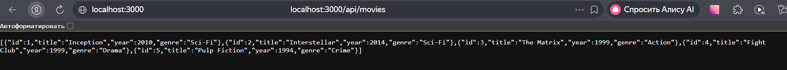
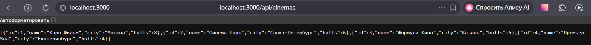
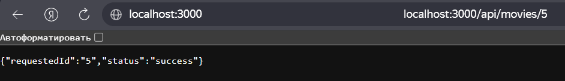
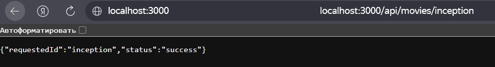
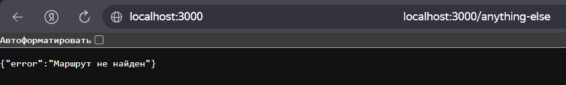

# Лабораторная работа №1: Настройка среды разработки и первый HTTP-сервер

**Студент:** Кулябцев Б.М.
**Группа:** ПИЖ-б-о-25-2
**Вариант:** 5
**Уровень:** Повышенный (Задание 3)
**Технология:** Node.js + Express

## Содержание

- [Цель работы](#цель-работы)
- [Теоретическое обоснование](#теоретическое-обоснование)
- [Выполнение практического примера](#выполнение-практического-примера)
- [Выполнение индивидуального задания](#выполнение-индивидуального-задания)
- [Контрольные вопросы](#контрольные-вопросы)
- [Вывод](#вывод)
- [Список использованных источников](#список-использованных-источников)

## Цель работы

Освоить установку инструментов для бэкенд-разработки, создать и запустить минимальный веб-сервер, обрабатывающий GET-запросы, понять концепцию эндпоинтов, научиться настраивать автоматический перезапуск сервера.

## Теоретическое обоснование

Бэкенд — это серверная часть веб-приложения, которая обрабатывает запросы клиентов, взаимодействует с базами данных, выполняет бизнес-логику и формирует ответы. Взаимодействие строится по клиент-серверной архитектуре: клиент (браузер, мобильное приложение) отправляет HTTP-запрос, сервер принимает его, обрабатывает и возвращает HTTP-ответ.

Эндпоинт — это URL вместе с HTTP-методом, по которому клиент обращается к серверу (например, `GET /api/movies`). Маршрут — механизм сопоставления пути запроса с кодом обработчика на стороне сервера. Метод GET предназначен только для получения данных и не должен изменять состояние сервера (идемпотентность). JSON — текстовый формат обмена данными, ставший стандартом де-факто для REST API.

Node.js — платформа для запуска JavaScript на сервере, Express — минималистичный веб-фреймворк для Node.js, упрощающий маршрутизацию, работу с middleware и формирование ответов. Nodemon — инструмент, автоматически перезапускающий сервер при изменении файлов проекта, что избавляет от ручного перезапуска во время разработки.

## Выполнение практического примера

Окружение: установлена LTS-версия Node.js, работа ведётся в терминале VS Code.

Команды создания проекта и запуска:

```bash
mkdir Laba1
cd Laba1
npm init -y
npm install express
npm install --save-dev nodemon
npm run dev
```

В `package.json` добавлены скрипты для запуска:

```json
"scripts": {
  "dev": "nodemon app.js",
  "start": "node app.js"
}
```

Сервер из практического примера (текстовый эндпоинт, JSON-эндпоинты, эндпоинт с параметром, обработка 404 и логирование) послужил основой для индивидуального задания — итоговый код приведён в следующем разделе.

Запуск сервера через `npm run dev` и лог входящих запросов в терминале:



## Выполнение индивидуального задания

**Вариант 5, повышенный уровень.** Требования: 5 эндпоинтов (1 текстовый, 2 простых JSON-эндпоинта, 1 JSON-эндпоинт с параметром в пути, 1 обработчик 404), автоматический перезапуск, консольное логирование всех запросов (метод + URL + время).

| Эндпоинт | Тип | Назначение |
|----------|-----|------------|
| `GET /` | текст | Корневой ответ |
| `GET /api/movies` | JSON | Коллекция фильмов |
| `GET /api/cinemas` | JSON | Коллекция кинотеатров |
| `GET /api/movies/:id` | JSON | Эндпоинт с параметром `id` в пути |
| любой другой | JSON, 404 | Обработчик несуществующих маршрутов |

### Код сервера (`app.js`)

```javascript
const express = require('express');
const app = express();
const port = 3000;

// Консольное логирование всех запросов
app.use((req, res, next) => {
  const time = new Date().toISOString();
  console.log(`[${time}] ${req.method} ${req.url}`);
  next();
});

// 1. Текстовый эндпоинт
app.get('/', (req, res) => {
  res.send('Сервер работает');
});

// 2. Коллекция: фильмы
app.get('/api/movies', (req, res) => {
  const movies = [
    { id: 1, title: 'Inception', year: 2010, genre: 'Sci-Fi' },
    { id: 2, title: 'Interstellar', year: 2014, genre: 'Sci-Fi' },
    { id: 3, title: 'The Matrix', year: 1999, genre: 'Action' },
    { id: 4, title: 'Fight Club', year: 1999, genre: 'Drama' },
    { id: 5, title: 'Pulp Fiction', year: 1994, genre: 'Crime' }
  ];
  res.json(movies);
});

// 3. Коллекция: кинотеатры
app.get('/api/cinemas', (req, res) => {
  const cinemas = [
    { id: 1, name: 'Каро Фильм', city: 'Москва', halls: 8 },
    { id: 2, name: 'Синема Парк', city: 'Санкт-Петербург', halls: 6 },
    { id: 3, name: 'Формула Кино', city: 'Казань', halls: 5 },
    { id: 4, name: 'Премьер Зал', city: 'Екатеринбург', halls: 4 }
  ];
  res.json(cinemas);
});

// 4. Эндпоинт с параметром в пути
app.get('/api/movies/:id', (req, res) => {
  const movieId = req.params.id;
  res.json({
    requestedId: movieId,
    status: 'success'
  });
});

// 5. Обработка 404
app.use((req, res) => {
  res.status(404).json({ error: 'Маршрут не найден' });
});

app.listen(port, () => {
  console.log(`Сервер запущен на http://localhost:${port}`);
});
```

### Команды для запуска и тестирования

```bash
npm run dev
```

Проверка выполнялась в браузере; эквивалентные команды `curl` собраны в файле [curl_commands.txt](curl_commands.txt):

```bash
curl -i http://localhost:3000/
curl -i http://localhost:3000/api/movies
curl -i http://localhost:3000/api/cinemas
curl -i http://localhost:3000/api/movies/5
curl -i http://localhost:3000/api/movies/inception
curl -i http://localhost:3000/anything-else
```

### Скриншоты работы эндпоинтов

**1. Текстовый эндпоинт** — `GET /`



**2. JSON-эндпоинт** — `GET /api/movies`



**3. JSON-эндпоинт** — `GET /api/cinemas`



**4. Эндпоинт с параметром** — `GET /api/movies/5`



Проверка с нечисловым значением — `GET /api/movies/inception`



**5. Обработка 404** — `GET /anything-else`



**Консольное логирование запросов** — каждый запрос выводится в терминал в формате `[время] МЕТОД URL`:


## Контрольные вопросы

**1. Что такое клиент-серверная архитектура?**
Модель взаимодействия, при которой клиент (браузер, мобильное приложение) отправляет запросы, а сервер их принимает, обрабатывает и возвращает ответы. Клиент отвечает за интерфейс, сервер — за данные и бизнес-логику.

**2. Какой протокол используется для общения клиента и сервера в вебе?**
HTTP (а в защищённом виде — HTTPS).

**3. Что такое эндпоинт (endpoint)?**
Конкретный URL вместе с HTTP-методом, по которому клиент обращается к серверу за ресурсом, например `GET /api/movies`.

**4. Какую структуру имеет HTTP-запрос и HTTP-ответ? Что такое код состояния?**
Запрос состоит из стартовой строки (метод, путь, версия протокола), заголовков и необязательного тела. Ответ — из строки статуса (версия, код состояния, пояснение), заголовков и тела. Код состояния — трёхзначное число, показывающее результат обработки запроса (200 — успех, 404 — не найдено, 500 — ошибка сервера).

**5. Что такое JSON? Почему он популярен в веб-разработке?**
JSON (JavaScript Object Notation) — текстовый формат обмена данными на основе пар «ключ — значение» и массивов. Он популярен, потому что компактен, легко читается человеком, поддерживается практически всеми языками и естественно сочетается с JavaScript.

**6. Как запустить сервер на Node.js?**
Установить зависимости (`npm install`) и выполнить `node app.js` или, через скрипт из `package.json`, `npm start`. Для разработки — `npm run dev` (запуск через nodemon).

**7. Что такое автоматический перезапуск сервера и зачем он нужен? Какой пакет используется для Node.js?**
Это перезапуск сервера при каждом изменении файлов проекта, чтобы не останавливать и не запускать его вручную. Для Node.js используется пакет `nodemon` (скрипт `"dev": "nodemon app.js"`).

**8. Какие коды состояния HTTP вы знаете? За что отвечает код 404?**
1xx — информационные, 2xx — успех (200 OK, 201 Created), 3xx — перенаправления (301, 302), 4xx — ошибки клиента (400, 401, 403, 404), 5xx — ошибки сервера (500). Код 404 Not Found означает, что запрошенный ресурс или маршрут на сервере не найден.

**9. Что такое middleware в Express?**
Функция вида `(req, res, next)`, которая выполняется между получением запроса и отправкой ответа: она может изменить запрос или ответ, завершить обработку или передать управление дальше вызовом `next()`. В работе middleware используется для логирования запросов (`app.use(...)`), а обработчик 404 — это middleware, стоящий после всех маршрутов.

**10. Как получить параметр из URL-пути в Express?**
Объявить параметр в маршруте (`/api/movies/:id`) и прочитать его через `req.params.id`. Значение приходит строкой.

## Вывод

В ходе работы была настроена среда разработки (Node.js, VS Code, npm), создан проект на Express и реализован HTTP-сервер по варианту 5 повышенного уровня: текстовый эндпоинт `/`, два JSON-эндпоинта (`/api/movies`, `/api/cinemas`), эндпоинт с параметром в пути `/api/movies/:id` и JSON-обработчик ошибки 404. Дополнительно реализовано консольное логирование всех запросов (метод, URL, время) и настроен автоматический перезапуск через nodemon.

Нового узнали: как устроены маршруты и middleware в Express, как читать параметры пути через `req.params`, что порядок регистрации обработчиков важен (обработчик 404 должен стоять последним), а также как формировать ответы в виде текста и JSON.

Трудности: <!-- ОПИШИТЕ СВОИМИ СЛОВАМИ, с чем реально столкнулись (например: установка Node.js, работа nodemon, оформление скриншотов). Если трудностей не было — так и напишите. -->

## Список использованных источников

1. Node.js. Официальная документация — https://nodejs.org/en/docs/
2. Express. Официальная документация — https://expressjs.com/
3. HTTP. MDN Web Docs — https://developer.mozilla.org/ru/docs/Web/HTTP
4. JSON. MDN Web Docs — https://developer.mozilla.org/ru/docs/Web/JavaScript/Reference/Global_Objects/JSON
5. Nodemon. Документация — https://nodemon.io/
