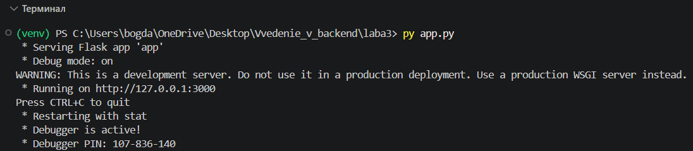
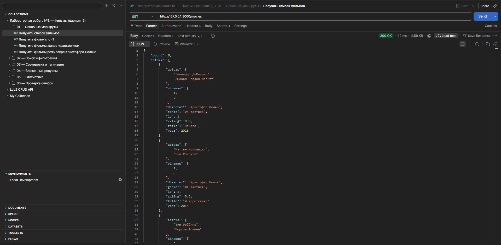
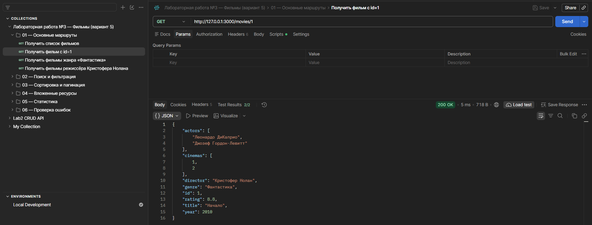
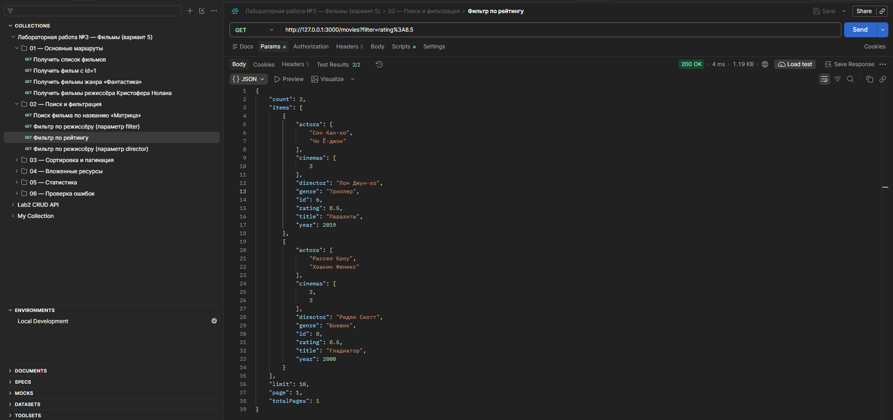
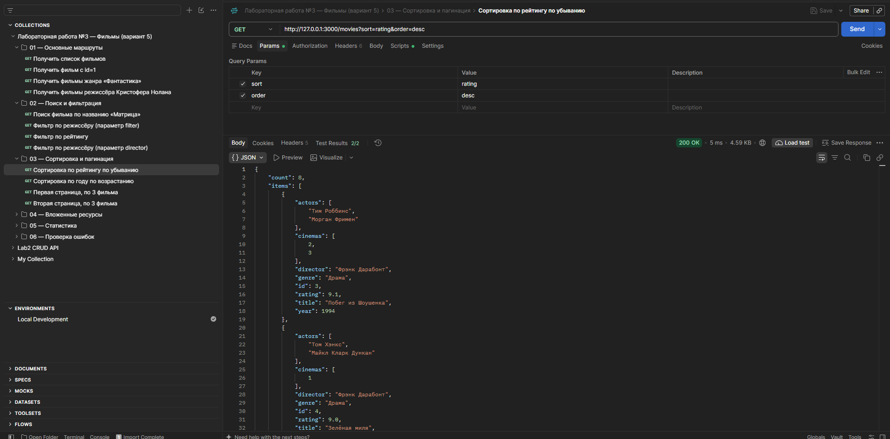
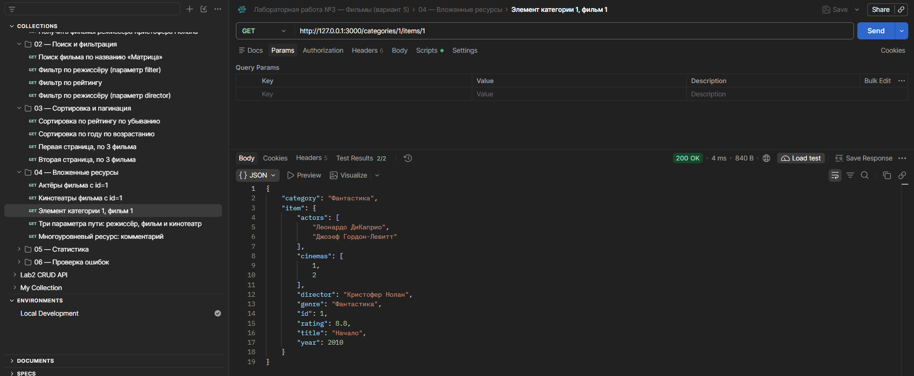
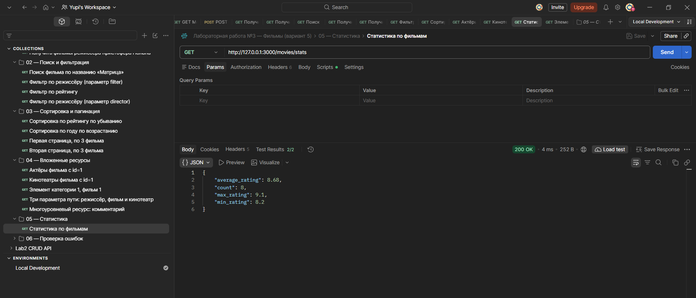
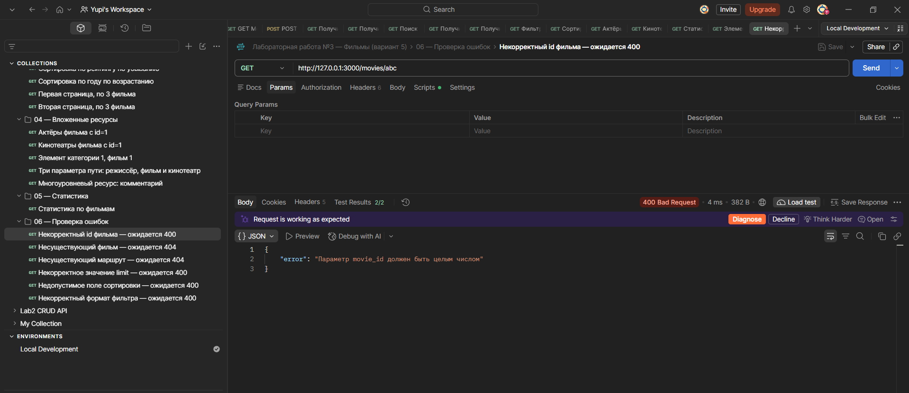
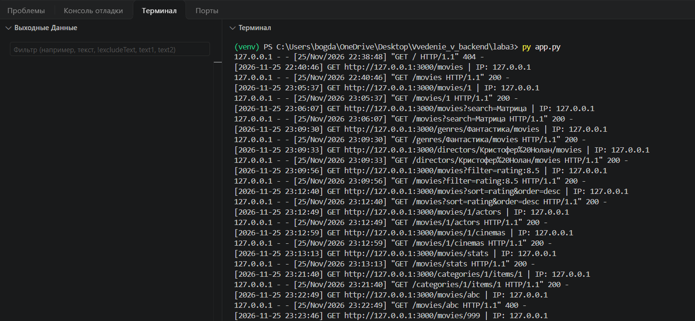

# Лабораторная работа №3. Маршрутизация, параметры пути и query-параметры

<div align="center">

**Студент:** Кулябцев Б.М.  
**Группа:** ПИЖ-б-о-25-2  
**Вариант:** 5 — сущность «Фильмы» (`movies`)  
**Уровень сложности:** продвинутый  
**Технологии:** Python, Flask, REST API

</div>

---

## 📑 Содержание

1. [Цель работы](#-цель-работы)
2. [Теоретическое обоснование](#-теоретическое-обоснование)
3. [Структура проекта и запуск](#-структура-проекта-и-запуск)
4. [Выполнение индивидуального задания](#-выполнение-индивидуального-задания)
5. [Маршруты API](#-маршруты-api)
6. [Тестирование](#-тестирование)
7. [Ответы на контрольные вопросы](#-ответы-на-контрольные-вопросы)
8. [Вывод](#-вывод)
9. [Список использованных источников](#-список-использованных-источников)

---

## 🎯 Цель работы

Освоить различные способы передачи данных через URL. Научиться строить гибкие маршруты с параметрами пути и query-параметрами, комбинировать их, обрабатывать вложенные ресурсы и валидировать входные данные. Изучить различия между параметрами пути, query-параметрами и телом запроса.

## 📚 Теоретическое обоснование

**Маршрутизация** — механизм сопоставления HTTP-запроса (метода и URL) с функцией-обработчиком на сервере. Во Flask маршрут задаётся декоратором `@app.route()`. Параметры пути являются частью URL и используются для идентификации конкретного ресурса, например `/movies/2`. В Flask параметры можно объявлять с типом, например `<int:movie_id>`, либо получать как строку и самостоятельно проверять корректность.

**Query-параметры** передаются после знака `?` и используются для поиска, фильтрации, сортировки и пагинации: `/movies?search=матрица&page=1&limit=5`. Во Flask они доступны через `request.args.get()`. В отличие от параметров пути, query-параметры обычно необязательны. Тело запроса (`request.json`) используется для передачи данных, например при создании или изменении ресурса.

**Вложенные маршруты** отражают связь ресурсов: `/movies/1/actors` возвращает актёров фильма, а `/movies/1/cinemas` — кинотеатры, в которых он представлен. Входные параметры необходимо валидировать: проверять тип, диапазон и допустимые значения. Для некорректных параметров используется `400 Bad Request`, для отсутствующего ресурса — `404 Not Found`. Неизвестные маршруты обрабатываются общим обработчиком 404.

## 🗂 Структура проекта и запуск

Структура проекта:

```text
Laba3/
├── app.py
├── requirements.txt
├── README.md
├── Laba3_Postman.json
├── screenshots/
│   ├── 01_server_start.png
│   ├── 02_get_all_movies.png
│   ├── 03_get_movie_by_id.png
│   ├── 04_search_and_filter.png
│   ├── 05_sorting_and_pagination.png
│   ├── 06_nested_routes.png
│   ├── 07_statistics.png
│   ├── 08_statistics.png
│   └── 09_error_handling.png
└── venv/                  # локальное виртуальное окружение
```

Файл `Laba3_Postman.json` содержит коллекцию запросов для Postman. Каталог `screenshots` содержит снимки проверок. Виртуальное окружение `venv` используется локально для запуска проекта.

### Установка и запуск в Windows 11

Откройте папку `Laba3` в Visual Studio Code. В терминале VS Code выполните:

```powershell
python -m venv venv
```

Активируйте окружение:

```powershell
.\venv\Scripts\Activate.ps1
```

Если PowerShell запретит активацию, можно использовать командную строку CMD:

```cmd
venv\Scripts\activate.bat
```

Установите зависимости:

```powershell
pip install -r requirements.txt
```

Запустите сервер:

```powershell
python app.py
```

Сервер будет доступен по адресу `http://127.0.0.1:3000`. Для остановки нажмите `Ctrl+C`.

## 🧩 Выполнение индивидуального задания

Вариант 5 — фильмы. Основные поля сущности: `id`, `title`, `year`, `rating`, `director`. Для продвинутого уровня добавлены связанные данные о кинотеатрах.

### Реализованные возможности

| Требование методички | Реализация |
|---|---|
| Получение всех элементов | `GET /movies` |
| Получение одного фильма | `GET /movies/<id>` |
| Вложенный ресурс варианта | `GET /movies/<id>/actors` |
| Элементы категории | `GET /genres/<genre>/movies` |
| Поиск по названию | `?search=...` |
| Сортировка | `?sort=year&order=desc` |
| Пагинация | `?page=1&limit=5` |
| Фильтрация по полям варианта | `?filter=director:Кристофер Нолан` или `?filter=rating:8.8` |
| Вложенные маршруты нескольких уровней | `/categories/<catId>/items/<itemId>` |
| Несколько параметров пути по шаблону задания | `/users/<userId>/posts/<postId>/comments/<commentId>` |
| Дополнительная связь режиссёр — фильм — кинотеатр | `/directors/<director>/movies/<movieId>/cinemas/<cinemaId>` |
| Wildcard и обработка 404 | общий маршрут в конце приложения и обработчик 404 |
| Валидация параметров | проверка ID, `sort`, `order`, `page`, `limit`, `search`, `filter` |
| Логирование | метод, URL, время и IP в консоли |
| Статистика | `GET /movies/stats` |
| Глобальная обработка ошибок | обработчик исключений с ответом 500 |

### Статистика

Эндпоинт `/movies/stats` возвращает количество фильмов, средний рейтинг, минимальный и максимальный рейтинг.

### Связь с кинотеатрами

Каждый фильм содержит список идентификаторов кинотеатров. Маршрут `/movies/<id>/cinemas` возвращает связанные кинотеатры. Дополнительно маршрут с параметрами режиссёра, фильма и кинотеатра проверяет согласованность всех трёх параметров.

### Полный листинг программы

Основная логика приложения находится в `app.py`.

<details>
<summary><strong>Показать полный код app.py</strong></summary>

```python
from flask import Flask, jsonify, request
from werkzeug.exceptions import HTTPException
from datetime import datetime
from functools import wraps
import logging
import math

app = Flask(__name__)
app.config["JSON_AS_ASCII"] = False

logging.basicConfig(level=logging.INFO, format="%(message)s")
logger = logging.getLogger("movies_api")

# Данные варианта 5. Хранятся в памяти и сбрасываются при перезапуске.
movies = [
    {
        "id": 1, "title": "Начало", "year": 2010, "rating": 8.8,
        "director": "Кристофер Нолан", "genre": "Фантастика",
        "actors": ["Леонардо ДиКаприо", "Джозеф Гордон-Левитт"],
        "cinemas": [1, 2]
    },
    {
        "id": 2, "title": "Интерстеллар", "year": 2014, "rating": 8.6,
        "director": "Кристофер Нолан", "genre": "Фантастика",
        "actors": ["Мэттью Макконахи", "Энн Хэтэуэй"],
        "cinemas": [1, 3]
    },
    {
        "id": 3, "title": "Побег из Шоушенка", "year": 1994, "rating": 9.1,
        "director": "Фрэнк Дарабонт", "genre": "Драма",
        "actors": ["Тим Роббинс", "Морган Фримен"],
        "cinemas": [2, 3]
    },
    {
        "id": 4, "title": "Зелёная миля", "year": 1999, "rating": 9.0,
        "director": "Фрэнк Дарабонт", "genre": "Драма",
        "actors": ["Том Хэнкс", "Майкл Кларк Дункан"],
        "cinemas": [1]
    },
    {
        "id": 5, "title": "Матрица", "year": 1999, "rating": 8.7,
        "director": "Лана и Лилли Вачовски", "genre": "Фантастика",
        "actors": ["Киану Ривз", "Лоренс Фишбёрн"],
        "cinemas": [2]
    },
    {
        "id": 6, "title": "Паразиты", "year": 2019, "rating": 8.5,
        "director": "Пон Джун-хо", "genre": "Триллер",
        "actors": ["Сон Кан-хо", "Чо Ё-джон"],
        "cinemas": [3]
    },
    {
        "id": 7, "title": "Остров проклятых", "year": 2010, "rating": 8.2,
        "director": "Мартин Скорсезе", "genre": "Триллер",
        "actors": ["Леонардо ДиКаприо", "Марк Руффало"],
        "cinemas": [1, 2]
    },
    {
        "id": 8, "title": "Гладиатор", "year": 2000, "rating": 8.5,
        "director": "Ридли Скотт", "genre": "Боевик",
        "actors": ["Рассел Кроу", "Хоакин Феникс"],
        "cinemas": [2, 3]
    }
]

cinemas = [
    {"id": 1, "name": "Премьер", "city": "Москва"},
    {"id": 2, "name": "Синема Парк", "city": "Санкт-Петербург"},
    {"id": 3, "name": "Каро", "city": "Казань"}
]

# Числовые идентификаторы категорий для демонстрации вложенных маршрутов.
categories = {
    1: "Фантастика",
    2: "Драма",
    3: "Триллер",
    4: "Боевик"
}

# Пример многоуровневого ресурса с тремя параметрами пути.
users_posts_comments = [
    {"user_id": 1, "post_id": 10, "comment_id": 100,
     "text": "Отличный фильм!", "author": "Алексей"}
]


@app.before_request
def log_request():
    """Логирует метод, URL, время запроса и IP клиента."""
    timestamp = datetime.now().strftime("%Y-%m-%d %H:%M:%S")
    ip_address = request.headers.get("X-Forwarded-For", request.remote_addr)
    logger.info("[%s] %s %s | IP: %s",
                timestamp, request.method, request.url, ip_address)


def parse_positive_id(value, parameter_name="id"):
    """Преобразует параметр в положительное целое число или возвращает ошибку."""
    try:
        number = int(value)
    except (TypeError, ValueError):
        return None, (jsonify({"error": f"Параметр {parameter_name} должен быть целым числом"}), 400)

    if number < 1:
        return None, (jsonify({"error": f"Параметр {parameter_name} должен быть положительным"}), 400)

    return number, None


def find_movie(movie_id):
    return next((movie for movie in movies if movie["id"] == movie_id), None)


# -------------------- СПИСОК, ПОИСК, ФИЛЬТРАЦИЯ И ПАГИНАЦИЯ --------------------

@app.route("/movies", methods=["GET"])
def get_movies():
    result = list(movies)

    search = request.args.get("search", "").strip()
    if len(search) > 100:
        return jsonify({"error": "Параметр search не должен превышать 100 символов"}), 400
    if search:
        result = [m for m in result if search.casefold() in m["title"].casefold()]

    # Поддерживаются фильтры вида filter=director:Имя и filter=rating:8.5.
    for filter_value in request.args.getlist("filter"):
        if ":" not in filter_value:
            return jsonify({"error": "Фильтр должен иметь формат field:value"}), 400
        field, value = filter_value.split(":", 1)
        if field not in ("director", "rating"):
            return jsonify({"error": "Разрешённые поля фильтрации: director, rating"}), 400
        if field == "rating":
            try:
                numeric_value = float(value)
            except ValueError:
                return jsonify({"error": "Значение rating должно быть числом"}), 400
            result = [m for m in result if m["rating"] == numeric_value]
        else:
            result = [m for m in result if m["director"].casefold() == value.casefold()]

    # Дополнительный короткий вариант фильтрации по режиссёру.
    director = request.args.get("director")
    if director:
        result = [m for m in result if m["director"].casefold() == director.casefold()]

    allowed_sort_fields = ["id", "title", "year", "rating"]
    sort = request.args.get("sort")
    order = request.args.get("order", "asc").lower()

    if order not in ("asc", "desc"):
        return jsonify({"error": "Параметр order должен быть asc или desc"}), 400
    if sort:
        if sort not in allowed_sort_fields:
            return jsonify({"error": f"Поле sort должно быть одним из: {', '.join(allowed_sort_fields)}"}), 400
        result.sort(key=lambda item: item[sort], reverse=(order == "desc"))

    # Проверяем значения отдельно, чтобы некорректные строки не превращались в значения по умолчанию.
    try:
        page = int(request.args.get("page", "1"))
        limit = int(request.args.get("limit", "10"))
    except ValueError:
        return jsonify({"error": "Параметры page и limit должны быть целыми числами"}), 400

    if page < 1:
        return jsonify({"error": "Параметр page должен быть не меньше 1"}), 400
    if limit < 1 or limit > 100:
        return jsonify({"error": "Параметр limit должен быть от 1 до 100"}), 400

    count = len(result)
    total_pages = math.ceil(count / limit) if count else 0
    start = (page - 1) * limit
    page_items = result[start:start + limit]

    return jsonify({
        "count": count,
        "page": page,
        "limit": limit,
        "totalPages": total_pages,
        "items": page_items
    })


# -------------------- СТАТИСТИКА --------------------

@app.route("/movies/stats", methods=["GET"])
def get_movie_stats():
    ratings = [movie["rating"] for movie in movies]
    return jsonify({
        "count": len(movies),
        "average_rating": round(sum(ratings) / len(ratings), 2) if ratings else 0,
        "min_rating": min(ratings) if ratings else None,
        "max_rating": max(ratings) if ratings else None
    })


# -------------------- ПАРАМЕТРЫ ПУТИ И ВЛОЖЕННЫЕ РЕСУРСЫ --------------------

@app.route("/movies/<movie_id>", methods=["GET"])
def get_movie(movie_id):
    numeric_id, error = parse_positive_id(movie_id, "movie_id")
    if error:
        return error
    movie = find_movie(numeric_id)
    if movie is None:
        return jsonify({"error": f"Фильм с id={numeric_id} не найден"}), 404
    return jsonify(movie)


@app.route("/movies/<movie_id>/actors", methods=["GET"])
def get_movie_actors(movie_id):
    numeric_id, error = parse_positive_id(movie_id, "movie_id")
    if error:
        return error
    movie = find_movie(numeric_id)
    if movie is None:
        return jsonify({"error": f"Фильм с id={numeric_id} не найден"}), 404
    return jsonify({"movie": movie["title"], "count": len(movie["actors"]), "actors": movie["actors"]})


@app.route("/movies/<movie_id>/cinemas", methods=["GET"])
def get_movie_cinemas(movie_id):
    numeric_id, error = parse_positive_id(movie_id, "movie_id")
    if error:
        return error
    movie = find_movie(numeric_id)
    if movie is None:
        return jsonify({"error": f"Фильм с id={numeric_id} не найден"}), 404
    related = [cinema for cinema in cinemas if cinema["id"] in movie["cinemas"]]
    return jsonify({"movie": movie["title"], "count": len(related), "cinemas": related})


@app.route("/genres/<genre>/movies", methods=["GET"])
def get_movies_by_genre(genre):
    result = [m for m in movies if m["genre"].casefold() == genre.casefold()]
    return jsonify({"genre": genre, "count": len(result), "movies": result})


@app.route("/directors/<director>/movies", methods=["GET"])
def get_movies_by_director(director):
    result = [m for m in movies if m["director"].casefold() == director.casefold()]
    return jsonify({"director": director, "count": len(result), "movies": result})


# -------------------- ДОПОЛНИТЕЛЬНЫЕ ВЛОЖЕННЫЕ МАРШРУТЫ --------------------

@app.route("/categories/<cat_id>/items", methods=["GET"])
def get_category_items(cat_id):
    category_id, error = parse_positive_id(cat_id, "cat_id")
    if error:
        return error
    genre = categories.get(category_id)
    if genre is None:
        return jsonify({"error": f"Категория с id={category_id} не найдена"}), 404
    result = [m for m in movies if m["genre"] == genre]
    return jsonify({"category": {"id": category_id, "name": genre},
                    "count": len(result), "items": result})


@app.route("/categories/<cat_id>/items/<item_id>", methods=["GET"])
def get_category_item(cat_id, item_id):
    category_id, error = parse_positive_id(cat_id, "cat_id")
    if error:
        return error
    movie_id, error = parse_positive_id(item_id, "item_id")
    if error:
        return error
    genre = categories.get(category_id)
    if genre is None:
        return jsonify({"error": f"Категория с id={category_id} не найдена"}), 404
    movie = find_movie(movie_id)
    if movie is None or movie["genre"] != genre:
        return jsonify({"error": "Фильм не найден в указанной категории"}), 404
    return jsonify({"category": genre, "item": movie})


# Три параметра пути: режиссёр, фильм и кинотеатр.
@app.route("/directors/<director>/movies/<movie_id>/cinemas/<cinema_id>", methods=["GET"])
def get_director_movie_cinema(director, movie_id, cinema_id):
    numeric_movie_id, error = parse_positive_id(movie_id, "movie_id")
    if error:
        return error
    numeric_cinema_id, error = parse_positive_id(cinema_id, "cinema_id")
    if error:
        return error

    movie = find_movie(numeric_movie_id)
    if movie is None or movie["director"].casefold() != director.casefold():
        return jsonify({"error": "Фильм указанного режиссёра не найден"}), 404

    cinema = next((c for c in cinemas if c["id"] == numeric_cinema_id), None)
    if cinema is None or numeric_cinema_id not in movie["cinemas"]:
        return jsonify({"error": "Кинотеатр не связан с указанным фильмом"}), 404

    return jsonify({"director": director, "movie": movie, "cinema": cinema})


# Многоуровневый пример с тремя параметрами пути из общей части задания.
@app.route("/users/<user_id>/posts/<post_id>/comments/<comment_id>", methods=["GET"])
def get_nested_comment(user_id, post_id, comment_id):
    parsed = []
    for value, name in ((user_id, "user_id"), (post_id, "post_id"), (comment_id, "comment_id")):
        number, error = parse_positive_id(value, name)
        if error:
            return error
        parsed.append(number)

    user_number, post_number, comment_number = parsed
    comment = next((c for c in users_posts_comments
                    if c["user_id"] == user_number
                    and c["post_id"] == post_number
                    and c["comment_id"] == comment_number), None)
    if comment is None:
        return jsonify({"error": "Вложенный комментарий не найден"}), 404
    return jsonify(comment)


# -------------------- ОБРАБОТКА ОШИБОК И WILDCARD --------------------

@app.errorhandler(404)
def not_found(error):
    return jsonify({"error": "Маршрут не найден"}), 404


@app.errorhandler(Exception)
def handle_unexpected_error(error):
    # HTTP-ошибки (например, 404) должны сохранять свой исходный статус.
    if isinstance(error, HTTPException):
        return jsonify({"error": error.description}), error.code
    logger.exception("Непредвиденная ошибка сервера: %s", error)
    return jsonify({"error": "Внутренняя ошибка сервера"}), 500


# Wildcard объявлен после всех конкретных маршрутов.
@app.route("/", defaults={"path": ""}, methods=["GET", "POST", "PUT", "PATCH", "DELETE"])
@app.route("/<path:path>", methods=["GET", "POST", "PUT", "PATCH", "DELETE"])
def wildcard(path):
    return jsonify({"error": "Маршрут не найден", "path": f"/{path}"}), 404


if __name__ == "__main__":
    app.run(host="127.0.0.1", port=3000, debug=True)

```

</details>

## 🧭 Маршруты API

| Метод | URL | Назначение |
|---|---|---|
| GET | `/movies` | Список фильмов, поиск, фильтрация, сортировка и пагинация |
| GET | `/movies/<id>` | Один фильм |
| GET | `/movies/<id>/actors` | Актёры фильма |
| GET | `/movies/<id>/cinemas` | Кинотеатры фильма |
| GET | `/movies/stats` | Статистика коллекции |
| GET | `/genres/<genre>/movies` | Фильмы указанного жанра |
| GET | `/directors/<director>/movies` | Фильмы режиссёра |
| GET | `/categories/<catId>/items` | Фильмы категории |
| GET | `/categories/<catId>/items/<itemId>` | Фильм внутри категории |
| GET | `/users/<userId>/posts/<postId>/comments/<commentId>` | Маршрут с тремя параметрами пути |
| GET | `/directors/<director>/movies/<movieId>/cinemas/<cinemaId>` | Проверка связи трёх ресурсов |
| GET | `/users/<userId>/posts/<postId>/comments/<commentId>` | Пример маршрута с тремя параметрами |
| любой | неизвестный URL | JSON-ответ 404 |

## 🧪 Тестирование

Проверка выполняется в Postman с помощью коллекции `Laba3_Postman.json`. Сначала запустите сервер командой `python app.py`, затем импортируйте JSON-файл через кнопку **Import** в Postman. После импорта откройте нужный запрос и нажмите **Send**. Базовый адрес запросов — `http://127.0.0.1:3000`.

| № | Запрос | Ожидаемый результат |
|---:|---|---|
| 1 | `GET http://127.0.0.1:3000/movies` | Список фильмов и данные пагинации |
| 2 | `GET http://127.0.0.1:3000/movies/1` | Информация о фильме «Начало» |
| 3 | `GET http://127.0.0.1:3000/movies/abc` | `400 Bad Request` |
| 4 | `GET http://127.0.0.1:3000/movies/999` | `404 Not Found` |
| 5 | `GET http://127.0.0.1:3000/movies/1/actors` | Список актёров |
| 6 | `GET http://127.0.0.1:3000/movies/1/cinemas` | Связанные кинотеатры |
| 7 | `GET http://127.0.0.1:3000/genres/Фантастика/movies` | Фильмы жанра «Фантастика» |
| 8 | `GET http://127.0.0.1:3000/movies?search=матрица` | Поиск по названию |
| 9 | `GET http://127.0.0.1:3000/movies?sort=rating&order=desc` | Сортировка по рейтингу |
| 10 | `GET http://127.0.0.1:3000/movies?page=1&limit=3` | Первая страница из трёх фильмов |
| 11 | `GET http://127.0.0.1:3000/movies?filter=director:Кристофер%20Нолан` | Фильмы выбранного режиссёра |
| 12 | `GET http://127.0.0.1:3000/movies?limit=101` | `400 Bad Request` |
| 13 | `GET http://127.0.0.1:3000/movies?sort=password` | `400 Bad Request` |
| 14 | `GET http://127.0.0.1:3000/movies/stats` | Количество и статистика рейтинга |
| 15 | `GET http://127.0.0.1:3000/categories/1/items` | Фильмы категории «Фантастика» |
| 16 | `GET http://127.0.0.1:3000/directors/Кристофер%20Нолан/movies/1/cinemas/1` | Данные фильма и связанного кинотеатра |
| 17 | `GET http://127.0.0.1:3000/unknown` | `404 Not Found` |
| 18 | `GET http://127.0.0.1:3000/users/1/posts/10/comments/100` | `200 OK`, вложенный ресурс с тремя параметрами пути |

## Скриншоты

Ниже размещены скриншоты, которые фактически присутствуют в каталоге `screenshots` проекта.

### 1. Запуск Flask-сервера



### 2. Получение списка всех фильмов



### 3. Получение фильма по ID



### 4. Поиск и фильтрация



### 5. Сортировка и пагинация



### 6. Вложенные маршруты



### 7. Статистика фильмов



### 8. Обработка ошибок



### 9. Логирование запросов



```markdown

```

## ❓ Ответы на контрольные вопросы

### 1. Что такое маршрутизация? Как она работает во Flask?

Маршрутизация — сопоставление HTTP-метода и URL с функцией, которая обрабатывает запрос. Во Flask маршрут задаётся декоратором `@app.route('/path')`, после чего при совпадении адреса вызывается соответствующая функция.

### 2. Чем отличаются параметры пути, query-параметры и тело запроса?

Параметры пути являются частью URL и идентифицируют ресурс, например `/movies/5`. Query-параметры идут после `?` и применяются для поиска и фильтрации, например `/movies?search=матрица`. Тело запроса передаёт данные отдельно от URL и обычно используется в POST, PUT и PATCH.

### 3. Как получить параметр пути во Flask?

Параметр объявляется в маршруте, например `@app.route('/movies/<movie_id>')`, а затем передаётся в функцию как аргумент `def get_movie(movie_id)`. Его значение нужно проверить и при необходимости преобразовать в число.

### 4. Как получить query-параметр во Flask?

Для этого используется `request.args.get('search')`. Значение можно получить со значением по умолчанию: `request.args.get('page', default='1')`.

### 5. Что такое вложенные маршруты?

Это маршруты, отражающие связь между ресурсами. Например, `/movies/1/actors` возвращает актёров конкретного фильма, а `/movies/1/cinemas` — кинотеатры, связанные с ним.

### 6. Какой код ответа возвращается при невалидном параметре?

Обычно возвращается `400 Bad Request`, поскольку клиент передал некорректное значение. В работе этот код используется, например, для нечислового ID, недопустимого поля сортировки и неправильного значения `limit`.

### 7. Какой код ответа возвращается, если ресурс не найден?

Возвращается `404 Not Found`. В приложении этот код используется, если фильма с указанным ID нет в коллекции или если связанный ресурс не найден.

### 8. Как реализовать поиск по подстроке через query-параметр?

Нужно получить строку из `request.args`, привести её и название к одному регистру и оставить элементы, в названии которых встречается искомая подстрока. В работе это реализовано параметром `search`.

### 9. Как реализовать сортировку по нескольким полям?

Нужно последовательно применить сортировку по каждому полю либо использовать составной ключ. Поля сортировки обязательно проверяются по белому списку, чтобы клиент не мог передать произвольное имя поля.

### 10. Как работает пагинация?

Пагинация делит результат на страницы. Для страницы `page` и размера `limit` начальный индекс равен `(page - 1) * limit`. Количество страниц рассчитывается как округление вверх от отношения количества элементов к размеру страницы.

### 11. Как ограничить максимальное значение limit?

Нужно преобразовать `limit` в целое число и проверить, что оно находится в диапазоне от 1 до 100. Если значение выходит за диапазон, сервер возвращает `400 Bad Request`.

### 12. Для чего нужен wildcard-маршрут?

Wildcard-маршрут обрабатывает URL, для которых не найден конкретный обработчик. Он должен располагаться после конкретных маршрутов, чтобы не перехватывать корректные запросы. В работе он возвращает JSON и статус 404.

### 13. Как реализовать глобальный обработчик ошибок?

Во Flask можно использовать декоратор `@app.errorhandler(Exception)`. Обработчик перехватывает непредвиденные исключения, записывает сведения об ошибке в журнал и возвращает клиенту JSON с кодом 500. HTTP-ошибки при этом должны сохранять собственные статусы.

### 14. Как логировать все запросы с IP-адресом клиента?

Для этого используется функция с декоратором `@app.before_request`. Она выполняется перед каждым запросом и записывает метод, URL, текущее время и IP-адрес клиента.

### 15. Как реализовать статистику по коллекции?

Нужно пройти по коллекции и вычислить количество элементов, среднее, минимальное и максимальное значение рейтинга. В работе это выполняет маршрут `GET /movies/stats`.

### 16. Как тестировать маршруты с параметрами в Postman?

Нужно выбрать HTTP-метод, указать полный URL с параметрами пути или query-параметрами и отправить запрос. Затем проверить статус ответа и JSON-тело. Для проверки ошибок следует отправлять, например, нечисловой ID и ID отсутствующего фильма.

### 17. Как проверить маршрут с несколькими параметрами пути?

Нужно отправить запрос к URL, содержащему несколько динамических сегментов, например `/users/1/posts/10/comments/100`. Каждый сегмент передаётся в функцию-обработчик как отдельный аргумент. Приложение проверяет корректность всех трёх значений и наличие соответствующего комментария.

## 📝 Вывод

В ходе лабораторной работы я реализовал REST-подобное API на Python с использованием Flask для предметной области «Фильмы». Я освоил маршрутизацию, параметры пути и query-параметры, реализовал поиск, фильтрацию, сортировку и пагинацию. Также я добавил вложенные маршруты для актёров и кинотеатров, проверку связанных ресурсов, статистику коллекции, логирование запросов и обработку ошибок. Проверка API позволяет убедиться в корректной обработке как успешных запросов, так и некорректных входных данных.

## 📖 Список использованных источников

1. Методические указания к лабораторной работе №3 «Маршрутизация, параметры пути и query-параметры».
2. Flask Documentation — https://flask.palletsprojects.com/
3. Werkzeug Documentation — https://werkzeug.palletsprojects.com/
